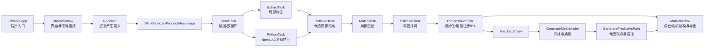

# S17：OntheflySfMFeedback 源码学习路线

状态：准备完成。环境、完整构建和功能复现已通过，源码学习统一以本机配置提交`f3d023b30e34164b840d8534fde05b9fa1988ec7`为基准。Visual Studio可以同时阅读、跳转和调试本项目的C++/CUDA、Qt及Python代码；Python脚本也可以直接在VS中打开。学习阶段继续使用`Release | x64`与已经验证的启动环境，避免为了“方便调试”先改变算法或依赖。

## 一、先建立完整调用图

本次trial02真实跑通的主链如下：

入口证据：`src/UI/main.cpp:25`是`main`；`src/UI/MainWindow.cpp:67`构造窗口，`233–238`连接Receiver、WorkFlow与界面，`259`进入StartReceive。`src/Workflow/Workflow.cpp:62`接收新图，`65–104`串联各任务，`117`处理注册成功，`164`连接Feedback完成事件。网格从`src/Scene/mesh.cpp:148`进入，并在`406`调用路径规划；`src/Scene/PathPlanner.cpp:646`是路径规划入口。

## 二、按六个单元学习

| 单元 | 阅读目标 | 建议文件 | 动手验证方式 | 通过标准 |
| --- | --- | --- | --- | --- |
| S17-A | 程序入口、Qt对象和信号槽 | `src/UI/main.cpp`、`MainWindow.cpp/.h`、`src/Workflow/Receiver.cpp/.h`、`Workflow.cpp/.h` | 在`main`、`MainWindow`构造函数、`StartReceive`、`onProcessNewImage`设断点；用trial02启动一次 | 能口述“点击Start Receive后第一张图怎样进入WorkFlow”，断点命中顺序与调用图一致 |
| S17-B | 单张影像数据在流水线中的生命周期 | `WorkData.h`、`ReadTask`、`ExtractTask`、`RetrieveTask`、`MatchTask`、`EstimateTask` | 只处理前几张图，观察imageID、路径、候选对、匹配及估计信号 | 能为一张图画出数据字段变化，并解释每个Task的输入/输出 |
| S17-C | 局部特征与Python全局检索 | `src/Feature`、`PythonTask.cpp`、`scripts/pyscripts/GlobalFeatureExtractor.py`、`NetVlad.py` | C++断在Python调用前后；Python独立重跑S10测试，对照2048维描述子 | 能区分SIFT局部描述子与NetVLAD全局描述子的用途，并找到模型加载和结果回传位置 |
| S17-D | 增量SfM核心 | `ReconstructTask.cpp`、`src/Scene`中的图像/相机/点管理、`src/Estimator`与BA相关文件 | 观察初始化影像对、第三张影像注册、一次BA；把日志中的2+126注册过程映射到源码 | 能解释初始化、2D–3D对应、位姿估计、三角化和BA在何时发生，以及128张为何是增量处理 |
| S17-E | Feedback算法 | `FeedbackTask.cpp`、`mesh.cpp`、`PathPlanner.cpp`及相关头文件 | 在第40/50/…张触发点观察输入点云、低质量面、聚类、候选视点、选中视点和路径 | 能解释末次3000低质量面、20簇、928候选、60视点、59段路径分别在何处产生；理解长三角形来源 |
| S17-F | 可视化、持久化和导出 | `MainWindow.cpp`、ModelViewer相关文件、数据库/模型写出代码 | 对照S15导出的数据库、text/bin模型、日志和匹配矩阵定位写出函数 | 能把界面中的相机、点、网格、质量、路径与导出文件逐项对应 |

## 三、每个单元的学习记录模板

每读完一个单元，记录以下五项，避免只浏览代码：

1. 入口函数与触发条件。
2. 主要输入、输出及拥有这些数据的类。
3. 至少一条实际运行值，例如imageID、匹配数量或选中视点数。
4. 对应的日志、界面或导出文件证据。
5. 仍不理解的问题，以及自己的暂定解释。

建议把断点放在业务函数入口，先使用条件断点或只跑少量图片。trial02全量运行适合最终核对，不适合每次单步。源码学习中的实验改动另建分支，例如`study/s17-notes`；已验证的`local/windows-setup`保持不变。

## 四、S17-A第一轮操作

1. 在Visual Studio打开`E:\sfm\OntheflySfMFeedback\OntheFlySfM.sln`，选择`Release | x64`，将UI设为启动项目。
2. 依次打开并阅读：`src/UI/main.cpp`、`src/UI/MainWindow.cpp`、`src/Workflow/Receiver.cpp`、`src/Workflow/Workflow.cpp`。
3. 设置四个断点：`main.cpp:25`、`MainWindow.cpp:67`、`MainWindow.cpp:259`、`Workflow.cpp:62`。
4. 从已经设置好运行环境的PowerShell启动VS或UI；需要调试时可在VS中附加到UI进程。创建或打开trial02项目后点击Start Receive。
5. 在每个断点记录：当前线程、函数参数、下一步会发出的Qt signal，以及接收它的slot。

S17-A通过标准：四类断点均能命中；能够独立画出`Start Receive → Receiver::newDataReceived → WorkFlow::onProcessNewImage`链路；能说明MainWindow为什么同时接收同一`newDataReceived`信号。完成后再进入S17-B。
